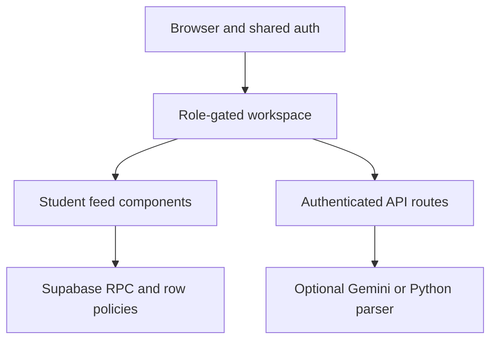

# Architecture and limits

## Application flow

Next.js serves the React application and server API routes. Supabase provides email/password auth, PostgreSQL, and image storage. The browser uses only a public anonymous key. Database policies and restricted functions authorize data access; a hidden navigation item is not an access control.

## Identity and profiles

`AuthProvider` restores the session and resolves its profile. It reports finite loading, signed-out, configuration, missing-profile, and error states. `RoleGate` restricts student/business layouts and keys workspace children by user identifier. An account change clears loaded account-specific UI.

Signup sends a display name and validated role as metadata. Database bootstrap creates the profile once. It does not change an existing role. Full profile rows remain owner-readable. Profile-image saves retain uncertain uploads for bounded retry rather than deleting an image that a delayed save may reference. Such uploads remain public until resolved or administratively cleaned. The profile form sends an allowlist of editable fields, not role, badge, rating, or verification flags.

Feed author projections expose only identifiers, display names, usernames, and avatars. Business student browsing has a separate business-only projection. Do not add a broad public profile policy to make a join work.

## Feed

Dashboard and community share one feed implementation. Cursor pagination uses timestamp plus UUID for a stable order. Each query limits page size. A unique post/user key makes a like idempotent. Counts come from stored engagement rows, not client-writable counters.

Posts and comments render plain text. Mutations retain generated identifiers for retries. Failed writes retain drafts and report a local error. Mutation identifiers bind immutable payloads; uncertain saves are reconciled before retry or attachment cleanup. New image references require an existing owned object, and storage cannot delete an object while a post references it. Refresh is explicit; this version does not use realtime subscriptions or ranking.

The visual system uses charcoal surfaces, restrained violet actions, Geist typography, common control variants, and semantic feedback. Token choices do not replace live keyboard, layout, or contrast checks.

## Business overview

The business dashboard reads account-owned jobs, proposals, contracts, and payment records. Counts are exact; recent lists use a stable newest-first order and a five-row limit. Caller filters supplement RLS. Open jobs remain discoverable to signed-in users, but the dashboard's job query includes only the current business. Private transaction/proposal records remain isolated by party.

Each section has an independent failure state. A failed count never becomes zero. Navigation uses existing routes or real section anchors. Contracts and payments are read-only for normal clients. Recorded amounts have no schema-level currency, so the dashboard does not invent a currency or sum an escrow balance. Nexawork does not process payments or hold escrow.

## Optional APIs and resume processing

API routes validate bearer tokens with Supabase before expensive work. They create caller-scoped database access, not service-role access. AI providers initialize only when needed. Missing configuration disables the affected optional operation, not the whole app.

Requests and provider responses have limits and timeouts. A capped process-local per-user throttle reduces accidental repeated requests. It is not a distributed production quota. Use provider-side budget controls and a distributed limiter before a multi-instance public production release.

Resume uploads accept TXT, PDF, and DOCX, up to 5 MiB. Server processing uses private unique directories beneath `RESUME_TEMP_ROOT` (default `/var/tmp`), generated filenames, `execFile`, bounded parser execution, and unconditional cleanup. The repository is not an upload directory. Raw resume/provider output must not appear in logs.

Resume content can reach an external AI provider. Public image buckets expose their contents to anyone with an object URL. Never upload confidential information without appropriate consent.

Practice badge completion uses an authenticated allowlisted function. Scoring remains client-side. These badges are practice records, not independent assessment or certification.

## Deployment boundary

The canonical schema lives in versioned Supabase migrations. `database/*.sql` files are historical context, not another setup path. Local resets are destructive and local-only. Back up hosted data and inspect the documented preflight before any adoption.

This change does not establish production scale, real escrow, payment settlement, moderation, or a production incident response process. A local integration result is not proof of hosted database compatibility, email delivery, or a real AI provider's behavior.
